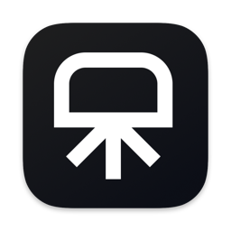

<div align="center">



# Omnicast

**A native macOS launcher that replaces Spotlight, with press-to-talk dictation that never leaves your Mac.**

macOS 14+ · Apple silicon · SwiftUI · no third-party Swift dependencies

</div>

---

Omnicast is two things that belong on the same keystroke:

- **A launcher that does one job properly.** Every installed application — Finder included — matched fuzzily and ranked by what you actually open, plus quick links to the Trash, Applications, Downloads and the rest. No file crawling, no web results, no noise.
- **Dictation that runs on your machine.** Hold the 🌐 fn key, talk, let go. The transcript lands at your cursor. Audio never leaves the device, and there is no account.

Alongside those, a searchable clipboard history and a record of everything you have ever dictated, both browsable from the launcher itself.

## Install

```bash
git clone git@github.com:haxzie/omnicast.git
cd omnicast
pnpm install          # for the web and API apps; the Mac app needs nothing
pnpm mac:run          # builds Omnicast.app and launches it
```

That builds, ad-hoc signs and opens the app. To keep it:

```bash
cp -R apps/mac/build.noindex/Omnicast.app /Applications/
```

### First run

| | |
|---|---|
| **Accessibility** | Required. Omnicast watches the fn key system-wide and synthesises ⌘V to paste transcripts. Grant it in Settings › Dictation. |
| **Microphone** | Prompted the first time you dictate. |
| **🌐 key** | Set System Settings › Keyboard › "Press 🌐 to" → **Do Nothing**, so macOS does not also act on the key. |
| **A speech model** | Open Models and download one. Base (English) at 59 MB is the right default. |

> **Signing.** `scripts/build.sh` uses the first Developer ID identity in your keychain and falls back to ad-hoc. Use a real identity if you have one: macOS identifies an app to TCC by its *code signature*, and an ad-hoc signature changes on every build — so each rebuild looks like a new app and Accessibility permission is asked for again. Override with `CODESIGN_IDENTITY=...`.

## Using it

| Shortcut | |
|---|---|
| <kbd>⌥</kbd><kbd>Space</kbd> | Open the launcher |
| <kbd>⌘</kbd><kbd>⇧</kbd><kbd>V</kbd> | Jump straight to clipboard history |
| <kbd>⌥</kbd><kbd>⇧</kbd><kbd>D</kbd> | Start / stop dictation |
| hold <kbd>🌐 fn</kbd> | Dictate while held — release to paste |
| tap <kbd>🌐 fn</kbd> | Dictate hands-free — tap again to finish |

All three chords are rebindable in Settings. Pressing another key while fn is held cancels, so fn+F3 and fn+arrow still behave normally; Escape aborts a hands-free take.

### Browsing clipboard and recordings

Type `clip` or `rec` in the launcher and the two browsers come up. Each is a list beside a detail pane that previews the highlighted entry — image, colour swatch, or text — over a table of where it came from and when.

| Key | |
|---|---|
| <kbd>↩</kbd> | Copy the entry to the clipboard |
| <kbd>⌘</kbd><kbd>↩</kbd> | Paste it straight into the app you were in |
| <kbd>⌫</kbd> | Back to the application search, once the filter is empty |
| <kbd>esc</kbd> | Back, then out |

Clipboard entries copied from a password manager are never recorded — Omnicast skips anything the source marks concealed or transient.

### Ranking that learns

Picking an app records it against **every prefix of what you typed** — `t`, `te`, `ter`, `term` — so two keystrokes next time already carry the evidence of the whole word. Type `s` for a week and Safari is simply first, even against apps that score higher on the raw match.

Weights decay when they are read rather than on a timer (30-day half-life for prefixes, 7 for plain recency), so a habit you drop fades on its own. With an empty query the list is pure prediction: ⌥Space then Return launches your most likely app.

Every decision is logged locally — the query, the candidates with their scores, which row won — so the ranking can be **measured** rather than guessed at:

```
$ Omnicast --replay-learning
Replayed 8 picks

               top-1     MRR
fuzzy only      0.0%   0.500
+ learning     87.5%   0.938

top-1 lift:  87.5%
```

Replay walks the log in order, scoring each decision with only what was known *before* it, so the number measures prediction rather than memorisation.

## Dictation

Omnicast transcribes through whichever local engine is available:

1. **whisper.cpp** with a model you downloaded in the app — the preferred path. Install the engine with `brew install whisper-cpp`, or point `OMNICAST_WHISPER_BIN` at your own build. Using the CLI rather than linking libwhisper keeps the app buildable with a plain `swift build` and lets you upgrade whisper independently.
2. **Apple's on-device recognizer** — no download, used only until you have a model. It refuses to run unless Siri and Dictation are enabled in System Settings, and reports itself as "supported" even when they are off, so download a model rather than relying on it.

Both run locally. Nothing is uploaded either way.

```
$ Omnicast --dictation-status
whisper.cpp:  /opt/homebrew/bin/whisper-cli
models:       Base (English)
active model: Base (English)
ready:        yes — whisper.cpp with Base (English)
```

Models download to `~/Library/Application Support/Omnicast/Models`, and the catalogue is served from `GET /v1/models` so new ones can ship without an app update.

While you talk, a drop of water rises from the bottom of the screen and stretches open into a glass pill carrying the Siri voice waveform — a Metal shader driven by your actual microphone level.

## Privacy

Everything is local-first and lives in `~/Library/Application Support/Omnicast/`:

| | |
|---|---|
| `clipboard.sqlite` | clipboard history |
| `dictation.sqlite` | transcripts |
| `usage.sqlite` | what the ranker has learned, plus its decision log |
| `Models/` | downloaded speech models |

No account, no telemetry, nothing uploaded. Sync is **off by default**; turning it on in Settings pushes transcript text and timings to a Worker that you deploy and own. Settings has a Reset for the learned ranking.

## Repository layout

```
apps/mac          SwiftUI menu-bar app (SwiftPM, zero third-party dependencies)
apps/web          Next.js 16 + Tailwind v4 — landing page and dictation dashboard
apps/api          Hono on Cloudflare Workers + Drizzle on D1 — optional history sync
packages/shared   Types and the speech-model catalogue shared by web and api
```

### The macOS app

```
Sources/Omnicast
├── App/         entry point, menu bar, AppEnvironment, action dispatch
├── Launcher/    the Spotlight-style NSPanel, its results and browsers
├── Search/      ranking, learning, replay, one provider per source
├── Clipboard/   pasteboard monitor and SQLite history
├── Dictation/   recorder, model downloads, transcription backends, fn-key gesture
├── Services/    SQLite wrapper, global hot keys, settings, API sync
└── UI/          glass materials, the dictation droplet and its Metal shader
```

See [apps/mac/README.md](apps/mac/README.md) for the design notes worth reading before changing anything — the non-obvious constraints are all written down there.

### Web and API

```bash
pnpm --filter @omnicast/api db:migrate:local
pnpm --filter @omnicast/api dev        # http://127.0.0.1:8787
pnpm --filter @omnicast/web dev        # http://localhost:3000
```

Deploying the API:

```bash
cd apps/api
pnpm wrangler d1 create omnicast       # put the id in wrangler.jsonc
pnpm db:migrate
pnpm wrangler secret put OMNICAST_API_TOKEN
pnpm deploy
```

With `OMNICAST_API_TOKEN` unset the API stays open so it runs locally with no setup. Set it before exposing the Worker.

## Development

```bash
cd apps/mac
swift test             # 58 tests: ranking, learning, gestures, audio, shader timing
./scripts/build.sh     # assembles and signs build.noindex/Omnicast.app
swift scripts/make-icon.swift Resources/AppIcon-source.png Resources/Omnicast.icns
```

A menu-bar app shows nothing at launch, which makes it awkward to test against. These flags open things directly, and all of them work over SSH or with the display asleep:

| Flag | |
|---|---|
| `--show-launcher[=query\|clipboard\|recordings]` | Open the launcher, optionally inside a browser |
| `--show-window[=models\|clipboard\|settings]` | Open the main window on a tab |
| `--show-droplet[=recording:0.4]` | Preview the dictation indicator at a given voice level |
| `--dump-results[=query]` | Print the ranked list with fuzzy and learned scores |
| `--dictation-status` | Report which engine and model would actually run |
| `--replay-learning` | Score the ranker against the pick log |

```
$ Omnicast --dump-results=te
query: te
 1. Terminal                     fuzzy=  181.6  learned=  233.0
 2. TextEdit                     fuzzy=  181.6  learned=    0.0
 3. Time Machine                 fuzzy=   81.6  learned=    0.0
```
